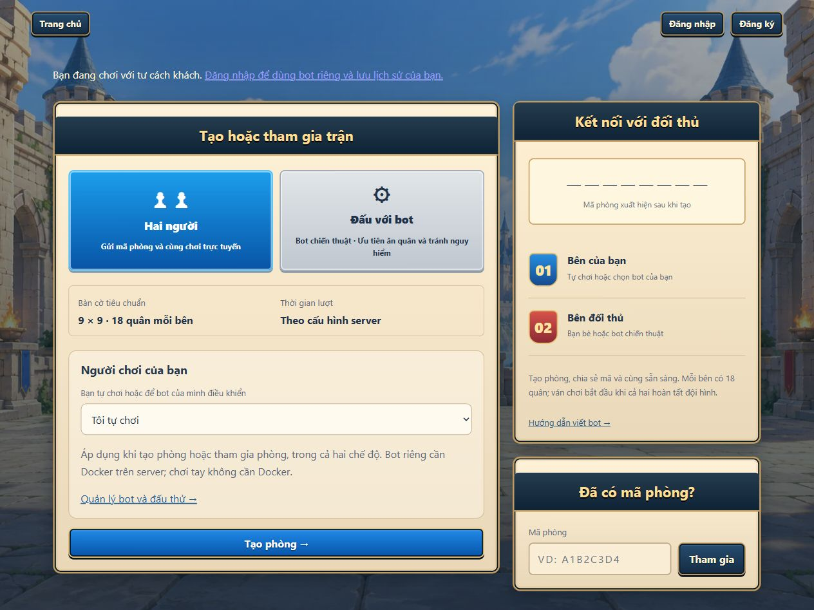

# Cách chơi một ván

Bạn chỉ cần trình duyệt và kết nối tới server game. Người chơi không phải cài Java, Docker hay worker. Đọc [Luật chơi](game-rules.md) trước nếu chưa quen bàn cờ.

## Chơi với bạn bè

1. Từ trang chủ bấm **Bắt đầu chơi →** để vào `/lobby.html`.
2. Chọn **Hai người**. Tại **Người chơi của bạn**, để **Tôi tự chơi**.
3. Bấm **Tạo phòng →**. Bàn cờ mở tại `/game.html`; dùng **Copy** để lấy mã phòng và gửi kèm địa chỉ website cho bạn của bạn.
4. Người còn lại mở cùng website, vào **Bắt đầu chơi →**, chọn controller của họ rồi nhập mã ở **Đã có mã phòng?** và bấm **Tham gia**. Mỗi phòng có hai ghế; không tạo một phòng mới để nhập chung ván.
5. Khi đủ hai bên, xếp đội hình. Chọn Búa/Bao/Kéo rồi bấm ô hợp lệ; chọn quân đã đặt rồi chọn ô khác để chuyển. **Ngẫu nhiên** xếp nhanh, **Đặt lại** xóa đội hình của bạn để xếp lại.
6. Đặt đủ 18 quân rồi bấm **Sẵn sàng**. Có thể **Hủy sẵn sàng** để sửa khi ván chưa bắt đầu. Khi cả hai sẵn sàng, server bắt đầu ván.
7. Đến lượt, chọn quân của mình rồi chọn ô được tô sáng. Theo dõi đồng hồ; khi cần có thể **Bỏ lượt** hoặc **Đầu hàng**.
8. Cuối ván, hộp kết quả cho biết thắng/thua/hòa. **Chi tiết** mở kết quả ván thường; tài khoản có thể xem lịch sử của mình. Trong giải, dùng **Quay lại giải** để theo dõi cặp đấu tiếp theo.

Khách có thể tự chơi trận thường. Đăng nhập để dùng bot riêng và gắn lịch sử mới với tài khoản; lịch sử khách trước đó không tự trở thành lịch sử của tài khoản.

Ảnh chụp giao diện thật tại server local ngày 23/10/2026, ở chế độ khách. Vị trí các nút có thể thay đổi theo kích thước cửa sổ.

## Đấu với bot có sẵn

Chọn **Đấu với bot** thay cho **Hai người**, để **Tôi tự chơi**, rồi tạo phòng. Server tự thêm bot chiến thuật ở ghế đối thủ và chuẩn bị đội hình của bot. Bạn xếp đủ quân, sẵn sàng và bắt đầu; không cần người thứ hai nhập mã.

## Cho bot của bạn điều khiển

1. Đăng nhập, vào **Bot của tôi** để tải bot của mình lên. [Hướng dẫn bot](../bot/bot-guide.md) có định dạng file và bot mẫu.
2. Trở lại lobby, chọn bot trong **Người chơi của bạn** trước khi **Tạo phòng** hoặc **Tham gia**. Đây là lựa chọn cho ghế của bạn trong cả hai mode.
3. Khi đủ ghế, bot riêng được server xếp quân ngẫu nhiên và sẵn sàng tự động. Bot chương trình hiện không điều khiển placement bằng protocol.
4. Khi ván chạy, bot chọn nước thay bạn; bạn không thể vừa điều khiển tay vừa gửi nước cho cùng ghế bot. Chủ ghế vẫn có thể đầu hàng/rời ván.

Chọn **Hai người** với bot riêng ở cả hai ghế sẽ cho hai bot đấu nhau. Chọn **Đấu với bot** và bot riêng ở ghế của bạn sẽ cho bot của bạn đấu bot chiến thuật có sẵn. Sandbox chạy ở phía server/worker, không phải trên máy người chơi; nếu server báo chưa hỗ trợ ngôn ngữ thì cần người vận hành xử lý.

## Mất kết nối và rời phòng

- Khi mất kết nối, trạng thái hiển thị **Mất kết nối — đang thử lại**. Chờ đồng bộ thành công rồi mới đi tiếp; đồng hồ trên server vẫn chạy.
- Để tải lại trang trong cùng tab hoặc quay lại bàn cờ, giữ thông tin ghế trong session của trình duyệt. Mã phòng dùng để tham gia ghế trống, không phải mật khẩu khôi phục ghế đang có chủ. Không chia sẻ token ghế hoặc dữ liệu session.
- **Rời phòng** trước khi thi đấu giải phóng ghế và đội hình của bạn. **Rời phòng** khi đang chơi được tính là đầu hàng, có hộp xác nhận.
- Phòng thường đang chơi nằm trong bộ nhớ server; không cam kết phục hồi ván đó sau khi server khởi động lại. Lịch sử/replay đã lưu là dữ liệu riêng.

## Vào giải đấu

Giải không sử dụng mã phòng để đăng ký. Từ trang chủ mở **Giải đấu**, đăng nhập rồi chọn giải ở trang khám phá. Các bước duyệt đơn, coding, kiểm thử và check-in nằm trong [Hướng dẫn tham gia giải](tournament-flow.md).

## Nguồn đối chiếu

Đối chiếu ngày 23/10/2026:

- [Lobby HTML](../../client/lobby.html), [lobby controller](../../client/js/pages/lobby.js), [bàn cờ](../../client/game.html), [đặt quân](../../client/js/game/placement-controller.js).
- [Game controller](../../client/js/game/game-controller.js), [GameSocket](../../client/js/socket/game-socket.js), [OnlineMatch](../../server/src/main/java/com/rpsbattle/online/OnlineMatch.java).
- [Account session](../../client/js/account/account-session.js), [game entry](../../client/js/pages/game.js).
