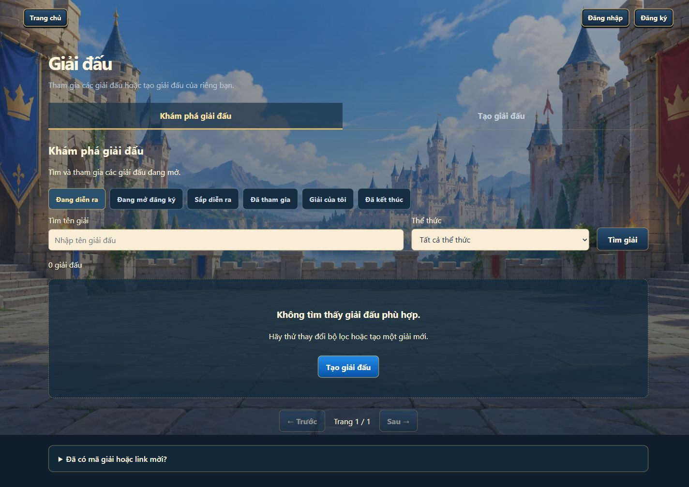

# Tham gia giải đấu

Mở **Giải đấu** từ trang chủ, đăng nhập và chọn giải trong trang khám phá `/tournaments.html`. Đọc **Luật giải**, cách tham gia và lịch trước khi đăng ký. Chủ giải vào giải của mình sẽ tới trang quản lý; hướng dẫn dưới đây dành cho tài khoản người tham gia.

Giao diện dùng giờ thiết bị để hiển thị lịch, nhưng **server quyết định giờ mở/đóng và quyền thao tác**. Thẻ **Việc của bạn** chỉ dẫn bước đang được phép làm. Nội dung chính bên dưới tự theo giai đoạn, không còn nhóm nút quay lại/Tổng quan/Đăng ký/Luật giải. **Giải đấu** trên thanh điều hướng đầu trang vẫn mở danh sách giải.

Các mục **Thông tin giải**, **Luật giải**, trận đấu, bảng xếp hạng, nhánh đấu và replay mở/thu gọn ngay trên cùng trang khi có nội dung phù hợp. Có thể dùng Tab và Enter/Space để mở các mục. Hash cũ như `#overview`, `#registration`, `#rules`, `#validation` và `#check-in` vẫn dẫn tới phần tương ứng; chúng không cấp thêm quyền. Nếu bạn không có quyền, đổi URL hoặc chỉnh đồng hồ máy không mở được bước tiếp theo.

## Giải bot có lịch coding

Luồng chính là: **Xem giải → đăng ký người chơi → được duyệt → chờ coding → viết/chọn bot → build và kiểm thử → READY → nộp bot → khóa bài → kiểm thử chính thức → check-in nếu bắt buộc → phòng chờ → thi đấu → kết quả**.

### 1. Đăng ký người chơi

Bấm **Đăng ký tham gia** trong **Việc của bạn**. Form mở ngay dưới thẻ, tự cuộn và focus trường đầu tiên. Mở **Thông tin giải** hoặc liên kết **Xem luật giải** cạnh checkbox không đóng form và vẫn giữ nội dung đã nhập trong lần mở trang đó. Bấm lại nút đăng ký chỉ cuộn và focus form hiện có.

Chọn ngôn ngữ dự kiến, điền trường/đội nếu được yêu cầu, đồng ý luật rồi bấm **Xác nhận đăng ký**. Khi gửi, nút hiện **Đang đăng ký…** và không nhận lượt gửi trùng. Lỗi hiển thị ngay dưới nút, giữ thông tin để sửa. Đây là đăng ký người tham gia; bạn chưa cần nộp bot ngay ở bước này. Với giải cho viết bot trên hệ thống, ngôn ngữ lập trình có thể đổi trong danh sách giải cho phép.

Server xác nhận thành công thì form đóng và **Việc của bạn** cập nhật đúng trạng thái chờ duyệt hoặc đã duyệt. Bấm **Xem đăng ký của tôi** để xem lại thông tin chỉ đọc; hiện chưa có chức năng sửa đơn đã gửi. Hành động hủy chỉ hiện khi server còn cho phép. Tải lại trang đọc trạng thái đã lưu từ server; dữ liệu form chưa gửi chỉ giữ trong phiên trang hiện tại. Cập nhật định kỳ giữ nguyên dữ liệu nhập và các mục đang mở; nếu đọc server thất bại, trang giữ nội dung hiện tại và báo cần cập nhật lại.

- **Đăng ký chưa mở (`UPCOMING`):** chờ mốc mở. Chủ giải có thể mở sớm; nếu không, server mở theo lịch khi giải đã được công bố.
- **Đang chờ ban tổ chức xác nhận (`NEEDS_REVIEW`; dữ liệu cũ có thể là `PENDING`):** đơn đã nhận, không cần gửi lại.
- **Đăng ký đã được chấp nhận (`APPROVED`):** có suất tham gia; chưa có nghĩa coding đã mở.
- **Danh sách chờ (`WAITLISTED`):** chưa có suất chính thức. Xem vị trí nếu được cung cấp; khả năng được chuyển vào phụ thuộc chỗ trống, chính sách và hạn xét duyệt.
- **Bị từ chối (`REJECTED`):** xem lời nhắn công khai gửi cho bạn. **Đã hủy (`CANCELLED`)** là bạn đã rút đơn; chỉ đăng ký lại nếu cửa đăng ký còn mở.

Việc duyệt có thể tự động, thủ công hoặc kết hợp theo luật giải. Hết giờ đóng đăng ký server không nhận đơn mới; đến giờ coding server chốt quyền vào workspace, không cần chờ chủ giải bấm chốt thủ công. Đơn chờ/chưa được duyệt không tự trở thành suất hợp lệ chỉ vì đã đến giờ coding. Chỉ dùng **Hủy đăng ký** khi giao diện còn cho phép.

### 2. Làm và nộp bot

Khi được duyệt và tới **Lập trình (`CODING_OPEN`)**, mở **Vào lập trình**. Chính sách giải quyết định có **Viết bot trên hệ thống**, **Dùng bot đã có** hay cả hai. Ngôn ngữ được phép cũng theo giải.

Với bot viết trên web: chọn ngôn ngữ, soạn code và bấm **Submit** bên dưới editor. Hệ thống chụp source, build, chạy test cases bắt buộc rồi cập nhật bản dự thi nếu đạt. Với bot có sẵn: chọn bot rồi dùng cùng nút Submit; bot gốc không tự thay đổi snapshot.

Kết quả hiện dưới nút: **AC** khi kiểm thử và chốt bài đều thành công; **CE, WA, TLE, MLE, RE** hoặc lỗi xử lý kèm thông báo khi không đạt. Lần mới thất bại giữ bản thành công trước đó. Có thể sửa tiếp bản nháp trong lúc máy chấm; thay đổi mới không sửa snapshot đã gửi.

Nháp tự lưu khi luật cho phép. Không cần chọn phiên bản, bấm build/test riêng hoặc đồng ý lại bằng checkbox. Lịch sử và hướng dẫn bot được thu gọn. Xem [hướng dẫn Submit](../bot/build-test-submit.md) khi gặp lỗi hoặc mất mạng.

### 3. Hết giờ: bài bị khóa

Tại hạn coding, server chặn chỉnh sửa, build, test và nộp mới. Tác vụ chưa hoàn thành READY trước hạn không được tính thành một phiên bản đủ điều kiện trước hạn.

- **Bắt buộc tự nộp (`REQUIRE_EXPLICIT_SUBMIT`):** cần có bài đã nộp hợp lệ; chỉ có READY mà chưa nộp vẫn có thể bị ghi nhận không có bài.
- **Tự nộp READY mới nhất (`AUTO_SUBMIT_LATEST_READY`):** server có thể chọn bản READY đủ điều kiện trước hạn. Bài đã khóa không bị thay bằng bản mới; quyền thay bài đã nộp còn tùy chính sách nộp lại.

Sau khi khóa, xem bản đã nộp/phiên bản chỉ đọc và thông báo của server. Nếu còn đoạn đang gõ chưa lưu, tải source để giữ lại; nó không được gửi vào bài thi sau hạn. Không có bản đủ điều kiện thì không có suất bot thi đấu. Trường hợp nộp khẩn cấp chỉ có khi chính sách hỗ trợ và ban tổ chức cấp riêng; người chơi không tự mở lại coding.

### 4. Kiểm thử chính thức

Trong **Kiểm thử**, bài đã khóa được đưa qua các bước: build, protocol, thời gian phản hồi, tài nguyên, nước đi hợp lệ, kiểm thử ẩn, kiểm thử theo luật giải và toàn vẹn bài nộp. Mỗi bước có trạng thái riêng, không suy luận kết quả từ số dấu tích đang hiện.

- `QUEUED` / `RUNNING`: đang chờ hoặc đang kiểm thử.
- `PASSED` nhưng chưa xác nhận áp dụng: tiếp tục chờ server.
- `PASSED` đã áp dụng: đủ điều kiện kiểm thử chính thức; theo dõi bước check-in.
- `FAILED`: bot chưa đạt; xem bước lỗi và thông báo ban tổ chức.
- `INFRA_ERROR`: hạ tầng kiểm thử bị gián đoạn; ban tổ chức cần xử lý/chạy lại, không phải kết luận bot đã thua.

READY trước hạn không thay thế kiểm thử chính thức. Không tải lại source khác để lách bài đã khóa.

### 5. Check-in và chờ bắt đầu

Trang lập trình/kiểm thử tự chuyển sang phần Check-in khi nhận giai đoạn mới từ server, kể cả khi bạn vẫn còn quyền xem source chỉ đọc. Không cần tải lại trang. Các chi tiết kiểm thử tải chậm không che nút check-in đã được server cho phép. Chuyển màn hình không tự xác nhận có mặt thay bạn.

Nếu giải yêu cầu, bấm **Check-in** hoặc **Check-in ngay** trong cửa sổ server công bố. Chỉ bấm được khi server xác nhận bài/đăng ký đủ điều kiện. Được duyệt, có READY hoặc đã nộp bot đều không tự xác nhận bạn có mặt.

Check-in thành công mở **Phòng chờ giải đấu**: kiểm tra giờ bắt đầu và thông báo. Nếu lỡ hạn, bạn không có tên trong danh sách thi đấu. Giải không bắt buộc check-in bỏ qua yêu cầu xác nhận này.

Đến giờ thi, server thử chuẩn bị và bắt đầu khi đủ điều kiện. Hết countdown không đảm bảo trận đã chạy: thiếu số người hợp lệ, validation, worker hoặc lỗi hạ tầng có thể chặn bắt đầu. Theo dõi **Việc của bạn** và thông báo.

### 6. Theo dõi trận và kết quả

Bot thi đấu tự động. Mở **Trận của tôi** để theo dõi chờ máy, khởi động, đang chạy, chờ xác nhận kết quả hoặc thử lại. Trận local có thể cho **Xem trận** khi có bàn cờ; trận remote hiện không có live board, theo dõi trạng thái và mở replay khi khả dụng.

Sau trận, server cập nhật tỷ số cặp đấu, bảng điểm hoặc nhánh đấu. BO3/BO5 có thể còn ván tiếp theo; thắng một ván chưa phải thắng cả cặp. Với loại trực tiếp, hòa cặp đấu được xử theo tổng quân sống rồi hạt giống; vòng bảng/Swiss có cơ chế bảng điểm và tie-break riêng của giải.

Bạn có thể phải chờ vòng hiện tại kết thúc, chủ giải mở vòng hoặc đối thủ/nhánh khác xác định xong. Bị loại vẫn có thể xem kết quả công khai, bracket và replay. Vào **Replay**, **Trận đấu** hoặc **Trận của tôi** để mở bản phát lại đã sẵn sàng. Có vấn đề, dùng **Báo cáo sự cố** khi trang giải cho phép.

## Giải thủ công hoặc có người tự chơi

Giải có người tự chơi dùng lịch thủ công, không có chuỗi coding tự động ở trên. Trong đăng ký, chọn **Tôi tự chơi** hoặc bot theo loại giải cho phép; bot đã có phải đủ điều kiện. Chủ giải duyệt, đóng đăng ký/chuẩn bị danh sách và điều khiển bắt đầu theo cấu hình.

Người chơi tay theo dõi **Sẵn sàng thi đấu**, xác nhận trong cửa sổ server cấp (hiện 30 giây), rồi **Vào trận** khi được cấp đúng ghế. Vắng ready có thể thua cả cặp đấu. Chơi BO3/BO5 có bước ready mới cho từng ván. Bot không cần bấm thay nước đi.

Với **Đồng đội / trường**, có thêm tab **Đồng đội** để tạo/gia nhập đội và đội trưởng chốt đội hình; đã được duyệt cá nhân không thay thế điều kiện đội hợp lệ. Các thể thức có trong source: Round Robin, loại trực tiếp, vòng bảng rồi loại trực tiếp, Swiss và đồng đội. Xem **Luật giải** để biết cấu hình thi đấu của giải bạn tham gia.

## Các trạng thái tạm dừng

**Giải tạm dừng (`PAUSED`)**: chờ chủ giải tiếp tục. **Chờ khôi phục (`RECOVERY_REQUIRED`)**: giải cần người quản lý xử lý sau gián đoạn; không tạo giải/phòng khác để tự nhận kết quả. **Đã hủy (`CANCELLED`)**: không tiếp tục thi đấu. **Kết thúc (`FINISHED`)**: xem kết quả và replay đã công bố.

> Screenshot: nội dung Đăng ký, Lập trình, bài bị khóa, Kiểm thử, Check-in, Phòng chờ và Trận của tôi trên desktop. Ảnh minh họa cần dùng phiên giải và tài khoản đúng vai trò.

Đọc từng bước: [Đăng ký](../tournament/registration.md) · [Coding](../tournament/coding-phase.md) · [Validation](../tournament/validation.md) · [Check-in](../tournament/check-in.md) · [Thể thức](../tournament/formats.md) · [Bracket/Ranking](../tournament/bracket-ranking.md). Tra [FAQ](faq.md) và [Thuật ngữ](../glossary.md).

## Giao diện khám phá giải trên desktop

Ảnh chụp toàn trang từ bản local ở viewport desktop 1440 × 900 ngày 24/10/2026. Danh sách đang rỗng ở bộ lọc được chọn; đây không phải ảnh một giải đã hoàn tất.

## Nguồn đối chiếu

Đối chiếu ngày 23/10/2026:

- [Phase resolver](../../server/src/main/java/com/rpsbattle/tournament/TournamentPhaseResolver.java), [TimelineStartService](../../server/src/main/java/com/rpsbattle/tournament/TimelineStartService.java), [TimelineAccessGuard](../../server/src/main/java/com/rpsbattle/tournament/timeline/TimelineAccessGuard.java), [timeline registrations](../../server/src/main/java/com/rpsbattle/tournament/timeline/TimelineRegistrationService.java).
- [WorkspaceStore](../../server/src/main/java/com/rpsbattle/tournament/coding/WorkspaceStore.java), [SubmissionStore](../../server/src/main/java/com/rpsbattle/tournament/coding/SubmissionStore.java), [CodingDeadlineService](../../server/src/main/java/com/rpsbattle/tournament/coding/CodingDeadlineService.java), [FinalValidationService](../../server/src/main/java/com/rpsbattle/tournament/coding/FinalValidationService.java).
- [Player next action](../../client/js/tournament/next-action.js), [registration](../../client/js/tournament/timeline-registration.js), [workspace](../../client/tournament-code.html), [check-in](../../client/js/tournament/timeline-check-in.js), [routes](../../client/js/tournament/tournament-routes.js), [format enum](../../server/src/main/java/com/rpsbattle/tournament/domain/TournamentFormat.java).
- [Knockout tie-break](../../server/src/main/java/com/rpsbattle/tournament/scheduler/SingleEliminationScheduler.java), [readiness](../../server/src/main/java/com/rpsbattle/tournament/TournamentReadyService.java).
