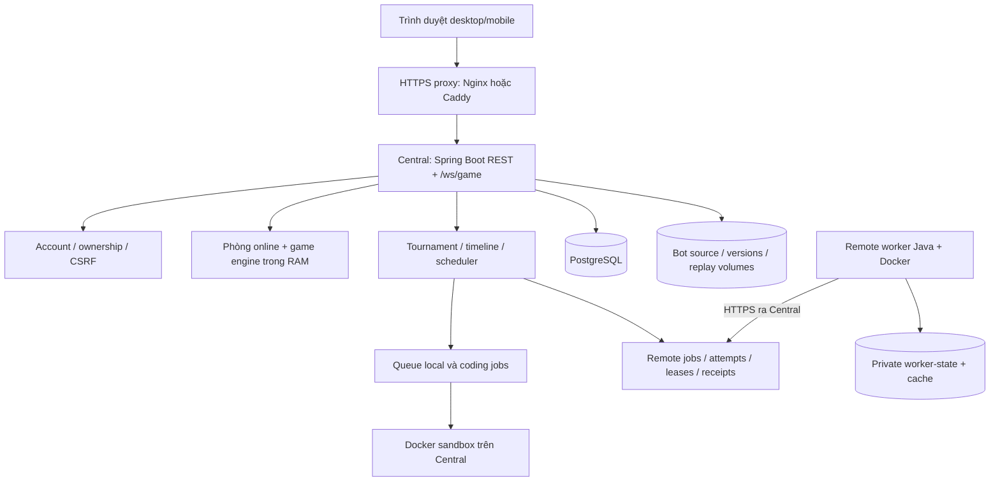

# Kiến trúc hệ thống

[Mục lục](../README.md) · [API](api.md) · [Database](database.md) · [Deployment](deployment.md)

Client là HTML/CSS/JavaScript trong `client/`, được Gradle đưa vào static resources của Spring Boot JAR. Một origin phục vụ UI, REST và WebSocket. Backend Java 21 dùng Spring Security/session, JPA/JDBC, Flyway và PostgreSQL; Docker chạy mã bot không tin cậy.

Mũi tên worker là kết nối outbound; Central không SSH vào worker. Remote worker không phải nơi chạy web/database và không thay queue build/test/final validation.

## Ranh giới trách nhiệm

- **Luật/game core:** engine kiểm tra placement, action, combat và kết quả. Cùng domain/protocol/replay source được biên dịch vào worker headless; không viết lại luật theo client.
- **Online:** REST tạo/join ghế, seat capability điều khiển phòng qua WebSocket, snapshot là nguồn state của UI. Phòng và session là RAM.
- **Tournament:** account ownership, policy/timeline, registration, seeding, rounds/series, ranking và review. Revision chống ghi trên snapshot cũ.
- **Coding:** workspace có revision, version/artifact bất biến, queue chạy build/public/sample/hidden, chọn bài tại cutoff, Final Validation và áp dụng kết quả.
- **Local execution:** worker pool/queue giới hạn số trận; Docker isolate mỗi bot. Sandbox nhận đúng file cần thiết, không có socket/DB của Central.
- **Remote execution:** job giữ spec/hash cố định; attempt cấp worker/slot/epoch/lease. Receipt bền vững tách khỏi projection vào giải, giúp retry upload không nhân đôi kết quả.
- **Persistence:** metadata, audit, freezes, jobs và receipts ở DB; source/artifact/replay còn có file. Backup chỉ DB không đủ.

Remote dùng hàng đợi chung, không dùng nhóm worker. Worker do Admin đăng ký có thể phục vụ nhiều giải; worker từ token chủ giải có scope cố định và chỉ phục vụ đúng giải đó. Server lọc scope cùng trust/runtime/capacity khi giao việc và kiểm tra quyền tại các bước thực thi. Giải mặc định AUTO khi chưa có policy riêng; chỉ quyết định chạy local trước lúc nhận job vào remote queue nếu không có máy phù hợp. Job đã nhận dùng lease/recovery để tránh chạy trùng. Xem [worker protocol](worker-protocol.md) và [schema V43/V44](database.md#điều-phối-worker-và-phạm-vi-theo-giải).

## Vòng đời dữ liệu

Save source → build version → kiểm thử theo policy → READY → submit/chọn tại deadline → freeze/hash → Final Validation → bài đủ điều kiện LOCKED → lịch trận → execution → result/replay → standings/bracket. Bước READY khác check-in người chơi và ready trước từng trận human.

Client nhận invalidation WebSocket rồi đọc lại view được phân quyền. Snapshot công khai không phải manager DTO; source/credential không nằm trong bảng public. Không dùng cache browser làm nguồn quyền hoặc làm chuẩn deadline.

## Giới hạn kiến trúc hiện tại

Vận hành **một Central replica**. Một số remote claim/receipt có transaction fence trong DB, nhưng toàn hệ thống vẫn có registry phòng/giải, session, queue local và rate-limit RAM; vì vậy không suy ra hỗ trợ nhiều Central chỉ từ một lock DB.

Restart không khôi phục bàn cờ giữa lượt. Giải đang dở có thể cần RECOVERY_REQUIRED và quyết định quản trị. Remote worker có journal/recovery riêng, không resume tiến trình bot đang chạy dở bằng cách đọc file state. Chưa có autoscaling Central, distributed session/rate limiter, remote live-board streaming hoặc lưu engine RAM đầy đủ.

Mốc synthetic control-plane/load test không phải benchmark số trận Docker hay cam kết số người dùng. Xem [Monitoring](monitoring.md) để đo trên hạ tầng thật.

## Nguồn đối chiếu

- [Đóng gói client và server](../../server/build.gradle), [worker chia sẻ core](../../worker/build.gradle).
- [Backend modules](../../server/src/main/java/com/rpsbattle/), [game core](../../server/src/main/java/com/rpsbattle/game/), [tournament](../../server/src/main/java/com/rpsbattle/tournament/).
- [Online gateway](../../server/src/main/java/com/rpsbattle/websocket/handler/OnlineGameGateway.java), [remote queue](../../server/src/main/java/com/rpsbattle/worker/remote/RemoteMatchQueue.java), [receipt](../../server/src/main/java/com/rpsbattle/worker/remote/RemoteResultService.java).
