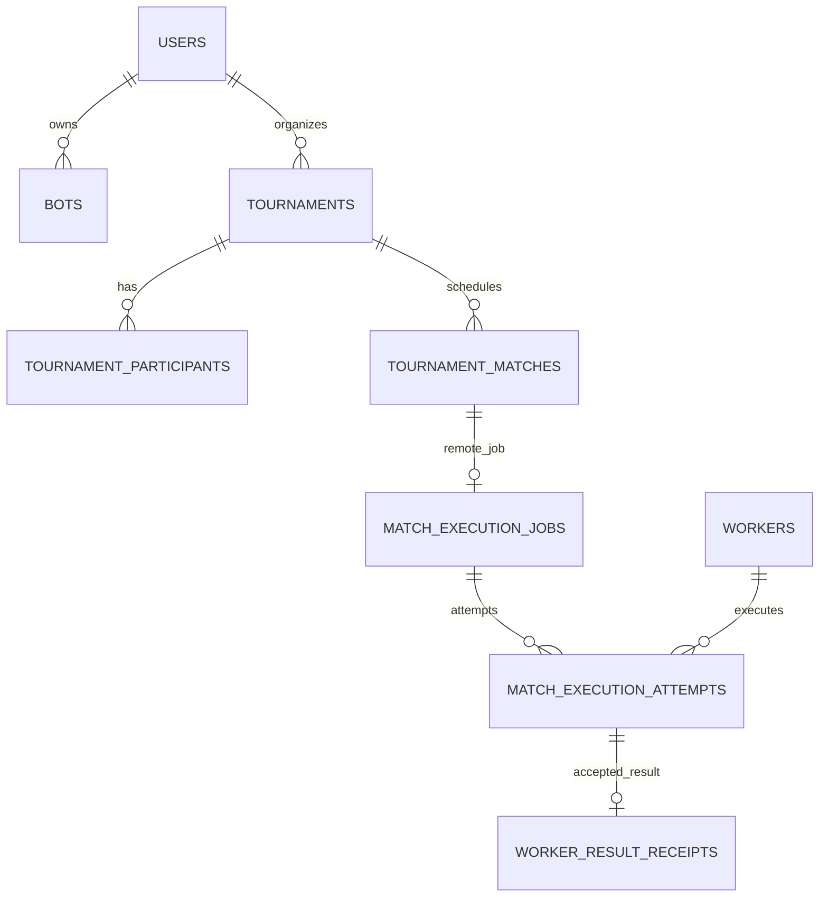

# Database, migrations và dữ liệu file

[Mục lục](../README.md) · [Kiến trúc](architecture.md) · [Backup/Recovery](backup-recovery.md)

Production dùng PostgreSQL. Compose hiện chọn PostgreSQL 17; app kết nối bằng role ứng dụng riêng, không dùng superuser. Hibernate `ddl-auto=validate`; **Flyway tạo/nâng schema khi startup**, nên database vừa tạo có bảng sau lần chạy app là đúng hành vi.

## Các nhóm dữ liệu chính

| Nhóm | Bảng tiêu biểu | Quan hệ/ý nghĩa |
| --- | --- | --- |
| Tài khoản | users, bots | User có role/status/authVersion; bot có owner_user_id, trạng thái và khóa hành chính. |
| Trận và replay | matches, match_participants, replays | UUID archive khác room ID; participants giữ danh tính ghế tại thời điểm thi đấu. Replay metadata trỏ tới file/hash. |
| Giải | tournaments, tournament_participants, tournament_matches | Chủ giải, policy/details, người dự thi và các trận. Revision/lock_version dùng chống mutation cũ. |
| Đăng ký | tournament_registrations, tournament_timeline_registrations, tournament_registration_controls | Luồng legacy và timeline khác nhau; không nhập nhằng APPROVED đơn với bản bot LOCKED. |
| Coding | tournament_code_workspaces, tournament_submission_versions, tournament_bot_submissions | Workspace source/revision; các version/hash; bản được chọn cho giải. |
| Jobs/freeze | bot_coding_jobs, tournament_coding_freezes, tournament_final_validations | Queue, cutoff/decision và validation/applied_at. |
| Audit | tournament_audit_events, bot_submission_audit, admin_audit_events, admin_operation_events | Quyết định giải, bài nộp, quản trị đối tượng và journal HTTP. |
| Worker | workers, worker_credentials, worker_registration_tokens, worker_capabilities, worker_heartbeats | Credential/token hash khác nhau; heartbeat epoch/sequence tránh packet cũ cập nhật liveness. |
| Remote execution | match_execution_jobs, match_execution_attempts, worker_claim_receipts, worker_result_receipts, worker_execution_recoveries | Job/spec, nhiều attempt, idempotent claim/upload và recovery. |
| Routing/cleanup | worker_groups, worker_group_members, worker_capacity_limits, tournament_worker_policies, remote_job_routes, tournament_cleanup | Nhóm/giới hạn/routing và đánh dấu trash giải bỏ hoang. |

Chi tiết cột/constraint chính xác ở [SQL migrations](../../server/src/main/resources/db/migration/). Một số cấu trúc rounds/bracket/operations nằm trong dữ liệu details của giải; không giả định mỗi khái niệm UI đều có bảng riêng.

Sơ đồ là các quan hệ chính, không thay DDL đầy đủ hoặc mô tả toàn bộ nullable columns.

## Migrations và indexes

Repo có migrations đến **V41**, gồm SQL và Java migrations V10/V13 trong [db/migration Java](../../server/src/main/java/db/migration/). Không chỉ copy SQL vào pgAdmin rồi bỏ qua Java migration. Flyway lưu lịch sử/checksum; `clean-disabled=true`, `baseline-on-migrate=false`, validation naming bật.

Các index phục vụ owner/history theo account và thời gian; đăng ký theo tournament/status/waitlist_order; coding dispatch theo status/created_at; validation theo tournament/status/applied_at; remote FIFO, heartbeat expiry, lease expiry và projection receipt. Unique `(match_id, active_marker)` và `(worker_id, active_slot)` bảo vệ không giao trùng một trận/slot đang active.

Khi nâng cấp: backup nhất quán → dùng code mới chạy Flyway → chờ health/readiness → kiểm tra login/history/workspace/giải. Không sửa migration đã áp dụng, không `repair`/baseline để bỏ lỗi checksum khi chưa xác minh nguyên nhân. Không dùng Hibernate create/update hoặc down -v thay migration.

## File ngoài DB

`BOT_DIRECTORY` giữ metadata/source/versions/artifact liên quan; `REPLAY_DIRECTORY` giữ replay archive. Compose dùng named volumes bot-data và replay-data cùng postgres-data. Hash/ID trong DB không tự tái tạo byte source/replay đã mất. Worker cache là dữ liệu riêng khác volume Central.

Giữ ổn định COMPOSE_PROJECT_NAME và đường dẫn/volume khi nâng cấp. Thay env password chỉ thay tham số kết nối, không đổi password role đã tạo trong PostgreSQL. Init script [postgres-init.sh](../../infra/postgres-init.sh) chỉ chạy với volume database mới.

## Retention và cleanup

Archive bot là soft delete; không tự xóa file đang được lịch sử/bài khóa tham chiếu. Cleanup giải chỉ xét DRAFT trống bỏ hoang 14 ngày hoặc CANCELLED trống 7 ngày, không có lịch/đăng ký/người/đội, không có mốc tương lai, rồi qua grace 72 giờ và kiểm tra lại trước trash. Nội dung workspace/jobs/audit/remote records còn được service kiểm tra để tránh coi giải có hoạt động là rác.

Chưa có lịch purge toàn bộ artifact/replay tùy ý theo số ngày. Người vận hành đặt retention backup riêng và kiểm tra tham chiếu trước khi dọn. Không dùng tên giải/tên bot làm khóa xóa.

## Nguồn đối chiếu

- [Cấu hình JPA/Flyway](../../server/src/main/resources/application.yml), [prod datasource](../../server/src/main/resources/application-prod.yml), [Compose volumes](../../infra/docker-compose.yml).
- [Persistence giải](../../server/src/main/java/com/rpsbattle/tournament/persistence/TournamentPersistenceCoordinator.java), [cleanup](../../server/src/main/java/com/rpsbattle/tournament/cleanup/TournamentCleanupPolicy.java).
- [Remote constraints](../../server/src/main/resources/db/migration/V31__remote_match_claims.sql), [registration controls](../../server/src/main/resources/db/migration/V40__registration_close_and_roster_lock.sql).
